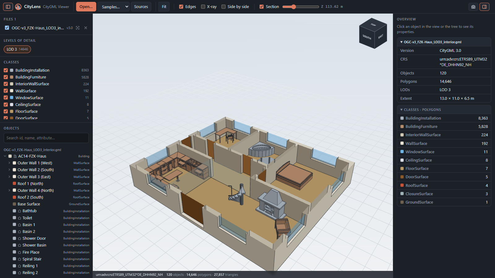

#  CityLens — CityGML Viewer

CityLens is a browser-based 3D viewer for CityGML 1.0 / 2.0 / 3.0 files (LOD 0–4), built with Vite + Three.js.
Files are read locally in the browser and never uploaded.



```bash
npm install
npm run dev      # http://localhost:5173
npm run build    # static site in dist/
```

## Features
- Open files via **Open…**, drag & drop, the sample tiles on the start screen, or **Samples…** (any `.gml` in
  `samples/`; see `samples/SOURCES.md`). `?sample=<file name>` opens a bundled sample directly, e.g.
  `?sample=OGC-v3_FZK-Haus_LOD3_interior.gml`. Local test files in `GMLs/` are also listed during `npm run dev`,
  but are never part of the build
- Semantic colouring (Roof / Wall / Floor / Ceiling / Door / Window / Room …), xlink-referenced geometry is drawn once
- Toggle by **LOD** (buttons over the top left of the view) and by **class** (Alt+click = show only that one)
- Object tree with search (id, name, attribute values)
- File overview (version, CRS, counts, LODs, extent, classes) while nothing is selected
- Click to pick: properties, generic attributes, group relations, polygon id, area and point in the source CRS
- **Storey filter** (CityGML 3.0 `Storey` objects): a lift-style picker under the view cube shows one floor at a time, ordered by `sortKey` or height. Each
  file is clipped to its own storey's height band; picking a storey hides ceilings, and "All" restores them
- **View cube**: click a face for that side, an edge for the 45° view between two sides, a corner for the
  isometric view (faces are named by compass direction: CityGML Y is north)
- Horizontal **section** plane for interiors (LOD4), **X-ray**, edges, PNG screenshot
- **Side by side** layout for files that are far apart or in different CRSs

Shortcuts: `F` zoom to selection · `Esc` clear · `Home` fit · `X` X-ray · `E` edges · `PageUp`/`PageDown` storey up/down

## Publishing
- The build uses relative paths, so `dist/` works from any folder or sub-path (e.g. GitHub Pages).
- Social previews need absolute URLs: build with the site's address to add `og:url` / `og:image`, e.g.
  `SITE_URL=https://<user>.github.io/<repo>/ npm run build`. Without it those two tags are simply left out.
- `npm run capture` (with `npm run dev` running) re-renders `docs/screenshot.png`, `public/og-image.png` and the
  PNG icons with a local headless Chrome or Edge (`CHROME=/path/to/browser` to pick one). The social card's layout
  is `scripts/social-card.html`; the icons come from `public/favicon.svg`.
- On GitHub, `public/og-image.png` can also be uploaded as the repository's social preview (Settings → General).

## Code
- `src/parser.js` – DOM-based CityGML parser + earcut triangulation into LOD/class buckets
- `src/viewer.js` – Three.js scene, materials, picking, highlighting, clipping
- `src/main.js` – UI: panels, tree, properties, loading
- `src/colors.js` – semantic colour scheme
- `src/navcube.js` – CSS 3D view cube that follows the camera
- `src/icons.js` – inline SVG icon set

## License
The code is MIT licensed, see [LICENSE](LICENSE). The sample files in `samples/` are third-party data under their own
terms (Apache-2.0, or no licence stated by the source); sources and details are in [samples/SOURCES.md](samples/SOURCES.md).
